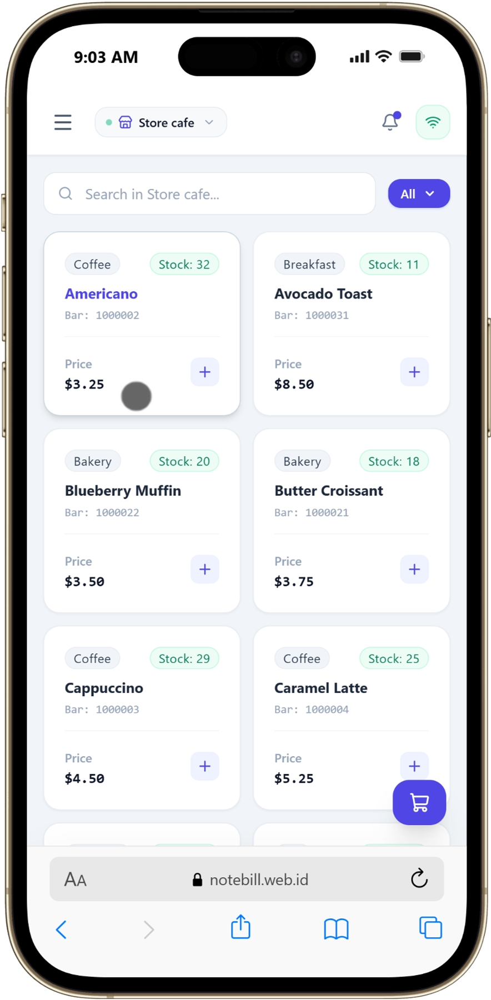
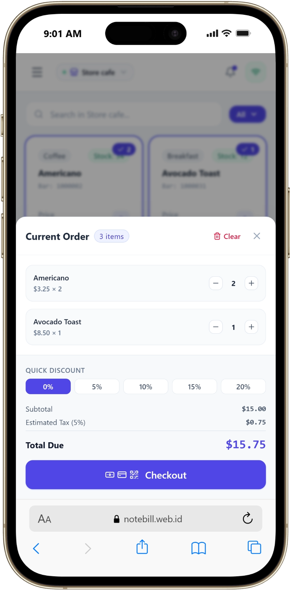
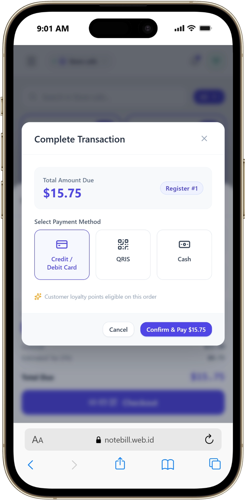
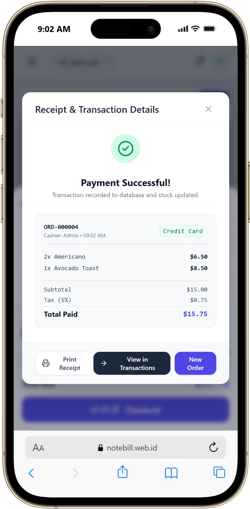
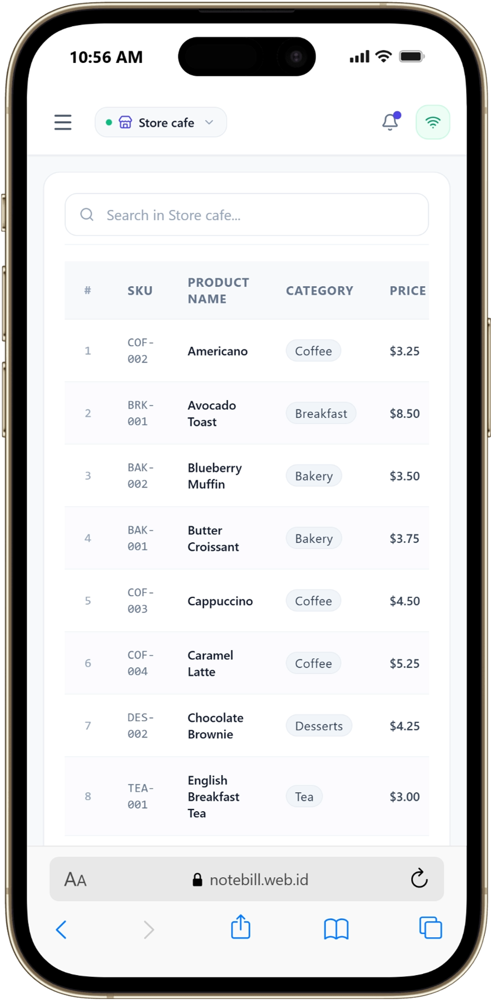
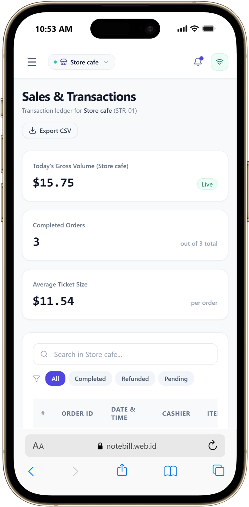
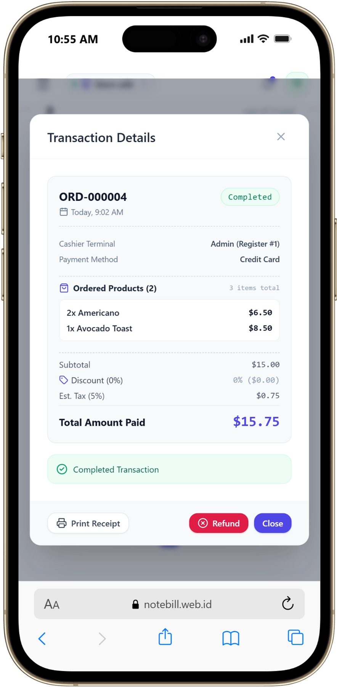
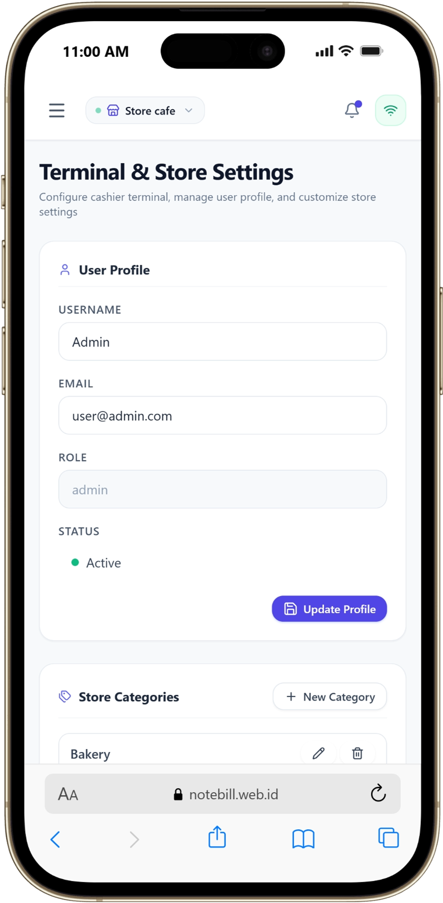

# note bill - Point of Sale (POS) Application

A modern, responsive Point of Sale application built with React, TypeScript, and Vite. This application is designed for retail environments to manage products, process sales, and handle customer transactions efficiently.

## Features

- **Product Management**: Add, edit, and categorize products with images and prices.
- **Sales Processing**: Intuitive interface to add items to cart, adjust quantities, and apply discounts.
- **Transaction History**: Track all sales with timestamps and order details.
- **User Authentication**: Secure login system for cashiers.
- **Responsive Design**: Seamless experience across desktop and mobile devices.
- **Theme Customization**: Light and Dark mode support.

## Screenshots

<table>
  <tr>
    <td></td>
    <td></td>
    <td></td>
  </tr>
  <tr>
    <td></td>
    <td></td>
    <td></td>
  </tr>
  <tr>
    <td></td>
    <td></td>
    <td></td>
  </tr>
</table>

## Getting Started

### Prerequisites

- [Node.js](https://nodejs.org/) (v16 or higher)
- [npm](https://www.npmjs.com/) (usually comes with Node.js)

### Installation

1. **Clone the repository**:

   ```bash
   git clone <repository-url>
   cd cashier-app
   ```

2. **Install dependencies**:

   ```bash
   npm install
   ```

3. **Run the development server**:

   ```bash
   npm run dev
   ```

4. **Open the application**:
   Open your browser and navigate to `http://localhost:5173` (or the port shown in your terminal).

## Development

### Available Scripts

- `npm run dev`: Start the development server with hot-reload.
- `npm run build`: Build the application for production.
- `npm run preview`: Locally preview the production build.
- `npm run lint`: Run the linter to check for code issues.

## Project Structure

```
cashier-app/
├── index.html
├── public/
│   ├── favicon.svg
│   └── icons.svg
├── src/
│   ├── assets/              # Static media, icons, and images
│   ├── components/          # Reusable UI components (buttons, modals, tables, pos widgets)
│   ├── hooks/               # Custom React hooks (useCart, useDateTime, useStoreSettings, useUserSettings)
│   ├── context/             # React context providers (AuthContext, etc.)
│   ├── services/            # API clients & data storage (supabaseClient, transactionStorage)
│   ├── utils/               # Helper & utility functions (transactionHelpers, etc.)
│   ├── App.tsx              # Root App component
│   ├── main.tsx             # Application entrypoint
│   ├── index.css            # Global Tailwind CSS definitions
│   ├── App.css              # App-level styling
│   ├── pages/               # Page views (PosPage, InventoryPage, TransactionsPage, SettingsPage, LoginPage)
│   └── configs/             # Application configs and route definitions
├── package.json
├── vite.config.ts
└── README.md
```

## Technologies Used

- **Framework**: React 18 with TypeScript
- **Build Tool**: Vite
- **Styling**: Tailwind CSS
- **State Management**: React Context API
- **Routing**: React Router DOM

## License

MIT License
