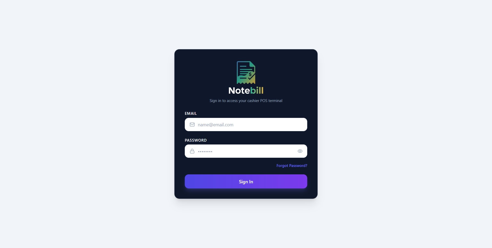
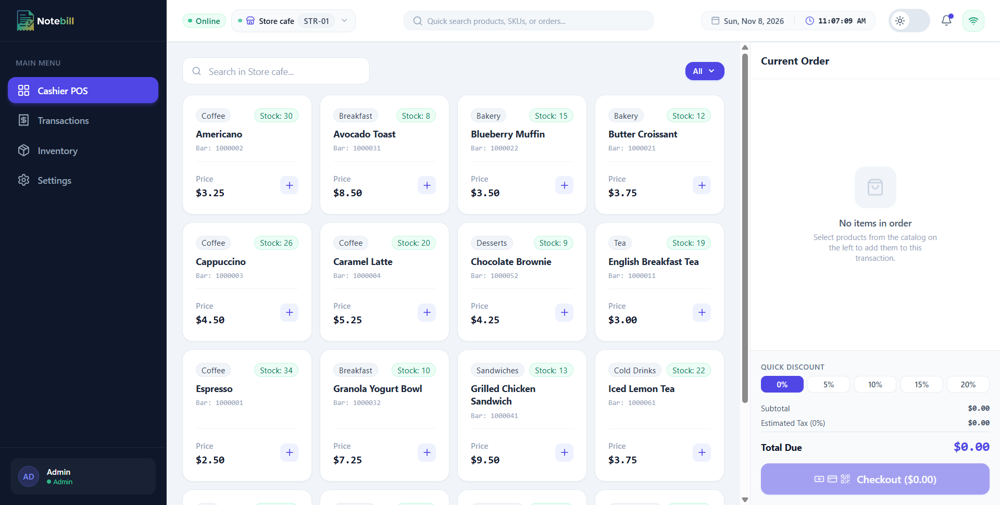
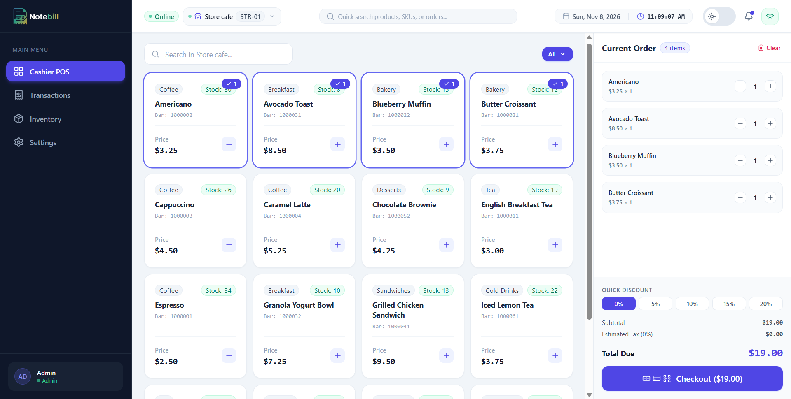
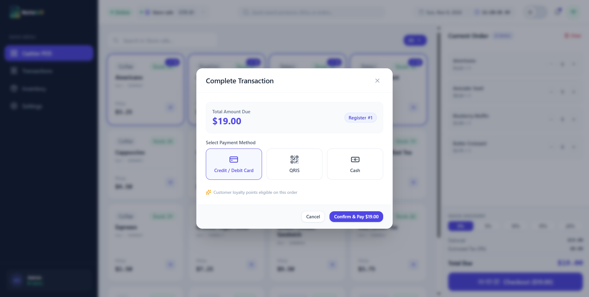
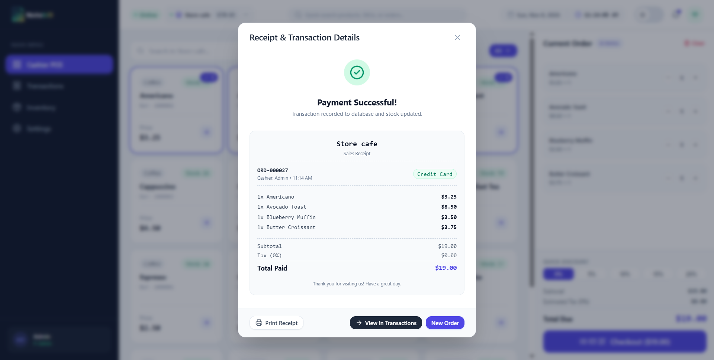
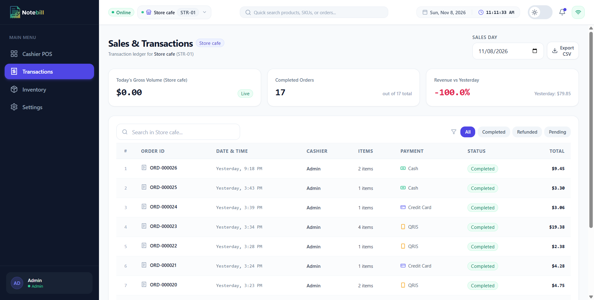
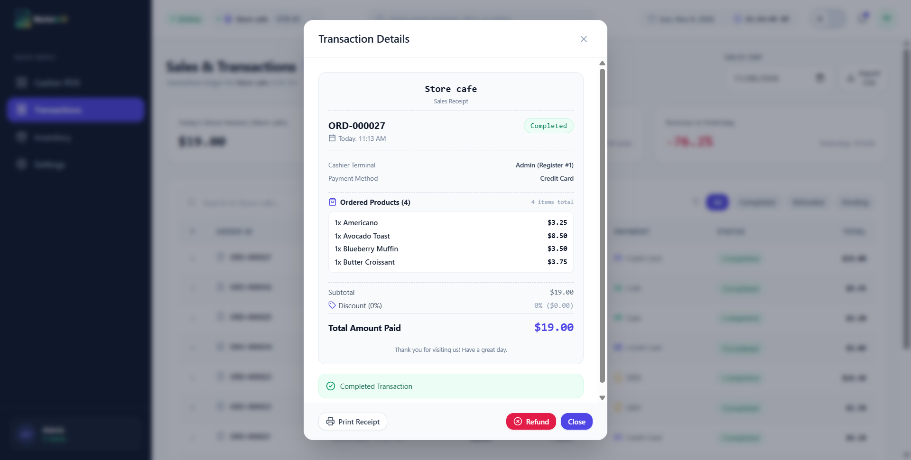
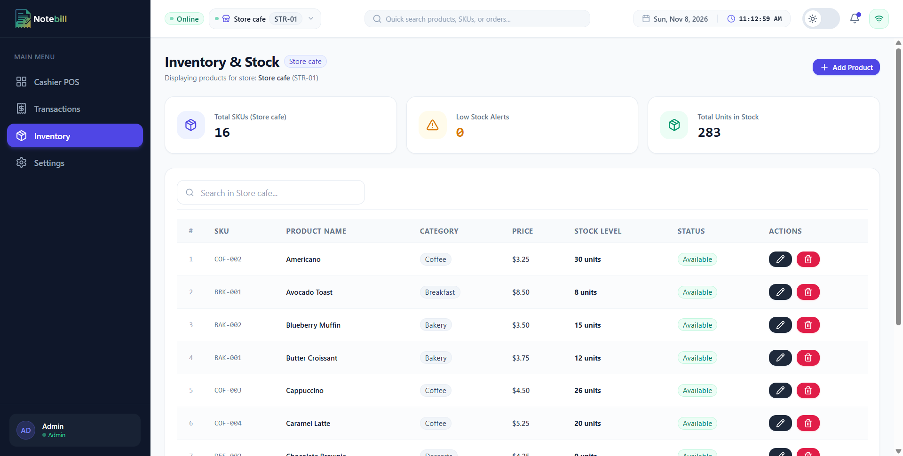
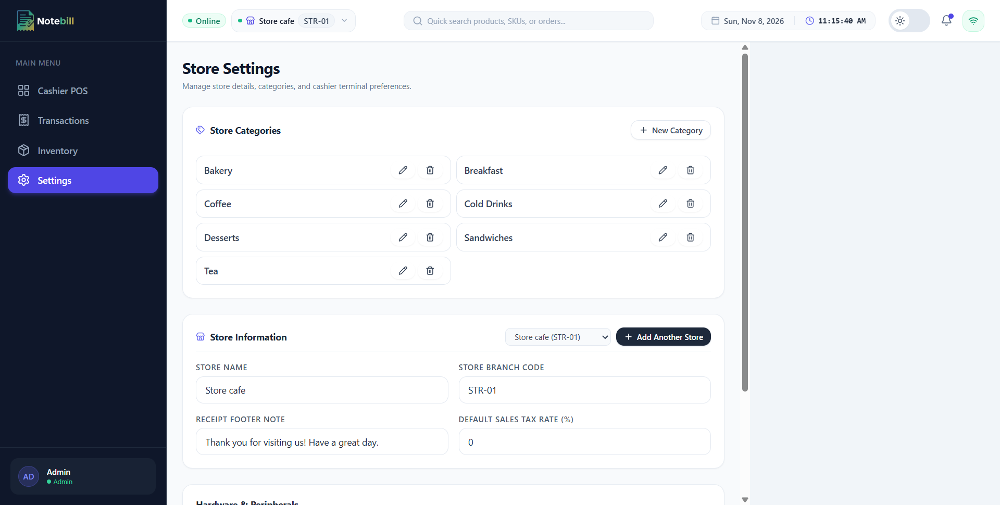
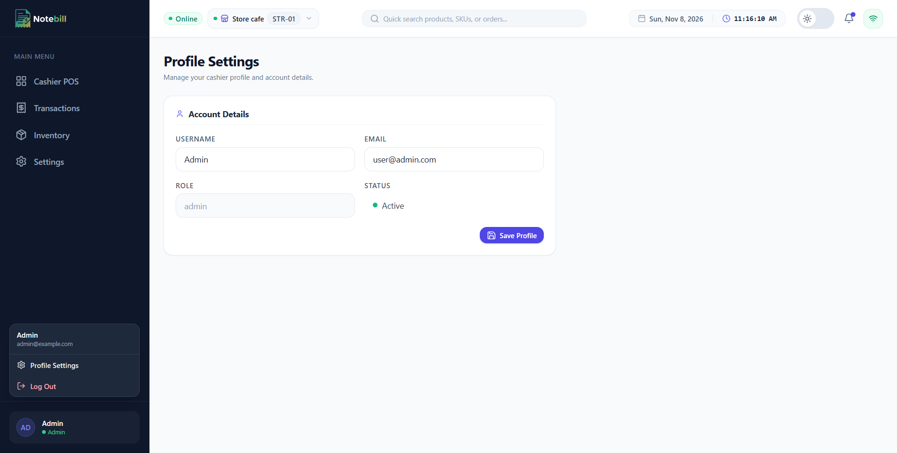

<p align="center">
  
</p>

# Notebill - Point of Sale (POS) Application

A modern, responsive Point of Sale application built with React, TypeScript, and Vite. This application is designed for retail environments to manage products, process sales, and handle customer transactions efficiently.

## Features

- **Multi-Store Support**: Create and switch between multiple stores with isolated products, categories, order counters, tax rates, and transactions.
- **Multi-Currency & Exchange Rates**: Store prices in base IDR with display and checkout conversion across IDR, USD, EUR, SGD, MYR, JPY, GBP, and AUD using customizable exchange rates.
- **Point of Sale (POS)**: Fast product search, category filtering, cart management, quick discounts, cash/card/QRIS checkout, and thermal receipt printing.
- **Inventory Management**: Add, edit, and delete products with SKU, barcode, stock levels, and low-stock alerts.
- **Transaction History & Refunds**: Paginated sales ledger, daily CSV export, detailed receipts, and atomic refunds with stock restoration.
- **Authentication & Recovery**: Supabase Auth login, user profile settings, and full password reset recovery flow.
- **Responsive & Theme Support**: Mobile-friendly layout with Light and Dark mode.

## Screenshots

<table>
  <tr>
    <td></td>
    <td></td>
  </tr>
  <tr>
    <td></td>
    <td></td>
  </tr>
  <tr>
    <td></td>
    <td></td>
  </tr>
  <tr>
    <td></td>
    <td></td>
  </tr>
  <tr>
    <td></td>
    <td></td>
  </tr>
</table>

## Getting Started

### Prerequisites

- [Node.js](https://nodejs.org/) (v20.19+ or v22+ recommended)
- [npm](https://www.npmjs.com/)
- A [Supabase](https://supabase.com/) project

### Installation

1. **Clone the repository**:

   ```bash
   git clone <repository-url>
   cd cashier-app
   ```

2. **Install dependencies**:

   ```bash
   npm install
   ```

3. **Configure environment variables**:
   Create a `.env` file in the project root:

   ```env
   VITE_SUPABASE_URL=https://<your-project-ref>.supabase.co
   VITE_SUPABASE_PUBLISHABLE_KEY=<your-supabase-publishable-or-anon-key>
   ```

4. **Initialize Supabase database**:
   Run `supabase/schema.sql` in the **Supabase Dashboard → SQL Editor** to create all required tables (`users`, `stores`, `categories`, `products`, `transactions`, `transaction_items`, `store_order_counters`), Row Level Security (RLS) policies, profile trigger, and atomic RPC functions (`next_store_order_number`, `adjust_product_stock`, `refund_transaction`).

5. **Configure Supabase Auth Redirect URLs**:
   In **Supabase Dashboard → Authentication → URL Configuration → Redirect URLs**, add your password reset URLs:
   - `http://localhost:5173/reset-password` (local development)
   - `https://<your-production-domain>/reset-password` (production)

6. **Run the development server**:

   ```bash
   npm run dev
   ```

7. **Open the application**:
   Open your browser and navigate to `http://localhost:5173` (or the port shown in your terminal).

## Development

### Available Scripts

- `npm run dev`: Start the development server with hot-reload.
- `npm run build`: Build the application for production.
- `npm run preview`: Locally preview the production build.
- `npm run lint`: Run the linter to check for code issues.

## Project Structure

```
cashier-app/
├── index.html
├── public/
│   ├── _redirects
│   ├── favicon.svg
│   └── icons.svg
├── supabase/
│   └── schema.sql           # Complete Supabase schema, RLS policies, triggers, and RPCs
├── src/
│   ├── assets/              # Static media, logos, and screenshots
│   ├── components/          # Reusable UI components (auth, inventory, pos, store, transactions)
│   ├── configs/             # Application configs and route definitions
│   ├── context/             # React context providers (AuthContext, StoreContext, ThemeContext)
│   ├── hooks/               # Custom React hooks (useCart, useCurrency, useDateTime, useStoreSettings, useUserSettings)
│   ├── pages/               # Page views (PosPage, InventoryPage, TransactionsPage, SettingsPage, ProfilePage, LoginPage, ResetPasswordPage)
│   ├── services/            # Supabase client & domain services (productService, transactionService, transactionStorage, categoryService, orderNumberService)
│   ├── utils/               # Helper functions (currency, transactionHelpers)
│   ├── App.tsx              # Root App component
│   ├── main.tsx             # Application entrypoint
│   ├── index.css            # Global Tailwind CSS definitions
│   └── App.css              # App-level & receipt print styling
├── package.json
├── vercel.json
├── vite.config.ts
└── README.md
```

## Technologies Used

- **Framework**: React 19 with TypeScript
- **Build Tool**: Vite 8
- **Backend & Auth**: Supabase (PostgreSQL, Auth, RLS, RPC)
- **Styling**: Tailwind CSS
- **State Management**: React Context API
- **Routing**: React Router DOM v7
- **Linter**: Oxlint

## License

MIT License
